<h1>Hi, I'm Mehedi!</h1>

<h3><a href="https://www.linkedin.com/in/mehediehteshum/">Software Engineer (Full Stack)</a>, <a href="https://www.linkedin.com/in/mehediehteshum/">IT System/Cloud Professional</a> from Canada</h3>

A Software and IT professional who turns business ideas into value-added services. I have experience and certifications in Software Development stacks, Cloud Computing, Information Technology, Customer Service and Engineering. I have owned, executed, coordinated, and collaborated on projects and delivered on time through planning, problem-solving, documentation, communication, and client handling. Continuous learning and development are integral parts of my career.

<h2>🎆 Projects </h2>

**Top Clients:** ✅ [Seaway](https://greatlakes-seaway.com/en/) | ✅ [Clayton Shagal](https://claytonshagal.com/ca/en/home.html) | ✅ [Canada Milk Marketing Board ](https://portal.nitamms.com/login)| ✅ [PJCCI](https://jacquescartierchamplain.ca/en/) | ✅ [Flextherm](https://quote.flextherm.com/en) | ✅ [Intelliva](https://intelliva.ca/) | ✅ [Upspace](https://upspace.ca/) | ✅ [Spiria](https://www.spiria.com/)  
**Back End:** ✅ [Contacts Management API](https://contacts-management-api.vercel.app/api/docs/) ([Readme](https://github.com/MehediEhteshum/contacts_backend/blob/main/README.md)) ✅ [Discover Canada - backend](https://github.com/MehediEhteshum/DiscoverCanada-Backend) & [webscrapper](https://github.com/MehediEhteshum/DiscoverCanada-Webscrapper)  
**Mobile:** ✅ [Safe Surf](https://github.com/MehediEhteshum/safe_surf/blob/main/README.md) ✅ [Discover Canada - frontend](https://github.com/MehediEhteshum/DiscoverCanada-Frontend)  
**Front End:** ✅ [PDF Library](https://github.com/MehediEhteshum/pdf_library/blob/main/README.md) | ✅ [NewsNest](https://news-nest-nine.vercel.app/) ([Readme](https://github.com/MehediEhteshum/news_nest/blob/main/README.md)) >> ongoing  
**Cloud / IT Systems:** ✅ [Windows Active Directory & GPO Implementation](https://github.com/MehediEhteshum/ad-gpo-ou/blob/main/README.md) | ✅ [Terraform: Multi-Cloud Environment Deployment](https://github.com/MehediEhteshum/terraform-deploy-env/blob/main/README.md) | ✅ [Oracle Cloud VM deployment Automation for Retries](https://github.com/MehediEhteshum/oracle_vm_arm_deploy/blob/main/README.md)  
**Cyber Security:** ✅ [Information Security Features Implementation](https://github.com/MehediEhteshum/InformationSecurityChallenges/blob/master/README.md) | ✅ [Password Encryption & Comparison](https://github.com/MehediEhteshum/InformationSecurityChallenge-BCrypt/blob/master/README.md) | ✅ [Penetration Testing Challenges](https://github.com/MehediEhteshum/PenTestChallenges_Py/blob/master/readme.md) | ✅ [Single Client Reverse Shell](https://github.com/MehediEhteshum/ReverseShellChallenge/blob/master/readme.md)  
**Game:** ✅ [Google Minesweeper Clone](https://github.com/MehediEhteshum/Minesweeper/blob/master/README.md) | ✅ [Asteroids: The Game](https://py2.codeskulptor.org/#user51_6V6JH4iIGLAJt3M_0.py)  
**Data Analysis:** ✅ [Car Price Data Wrangling and Viz](https://github.com/MehediEhteshum/CarPriceDataWranglingViz/blob/master/CarPrice-DataWrangling%26Viz.ipynb) | ✅ [Car Data - Exploratory Data Analysis](https://github.com/MehediEhteshum/CarDataExploratoryAnalysisViz/blob/master/CarData-EDA%26Viz.ipynb) | ✅ [Car Data - Model Development and Evaluation](https://github.com/MehediEhteshum/CarDataModelDevEvaluation/blob/master/CarData-MDE.ipynb)

<h3><a href="https://github.com/MehediEhteshum/MehediEhteshum/blob/main/DETAILS.md">CLICK HERE TO LEARN MORE ABOUT MY WORKS</a></h3>

<h2>🧰 Tools</h2>

<code>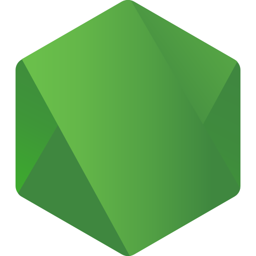 NodeJS</code>
<code> ExpressJS</code>
<code> Flutter</code>
<code>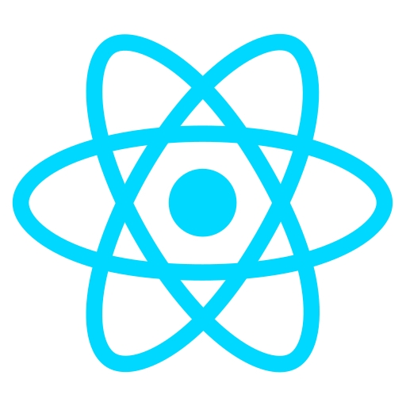 React</code>
<code> Django</code>
<code>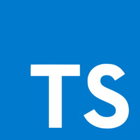 TypeScript</code>
<code>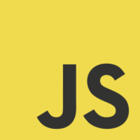 JavaScript</code>
<code>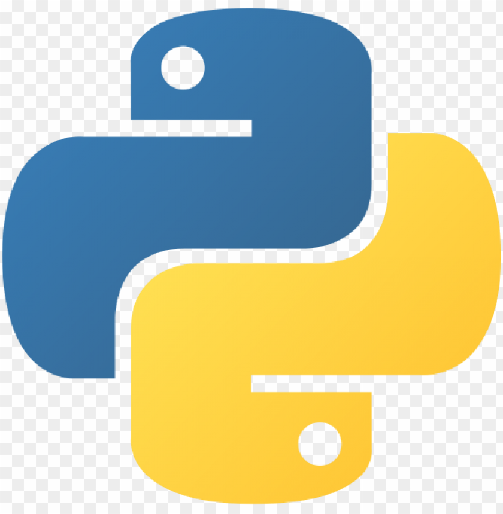 Python</code>
<code>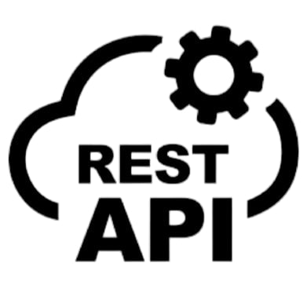 REST API</code>
<code>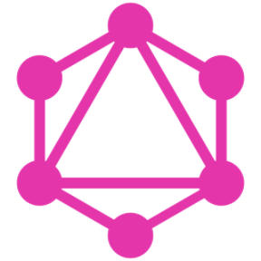 GraphQL</code>
<code>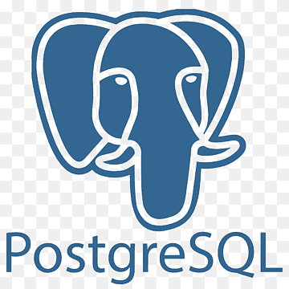 PostgreSQL</code>
<code>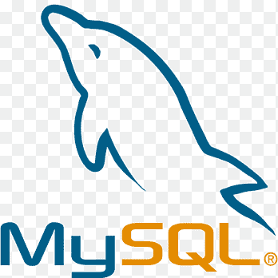 MySQL</code>
<code> MongoDB</code>
<code>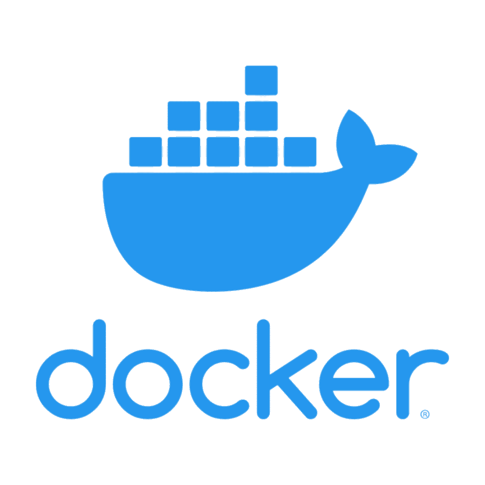 Docker</code>
<code>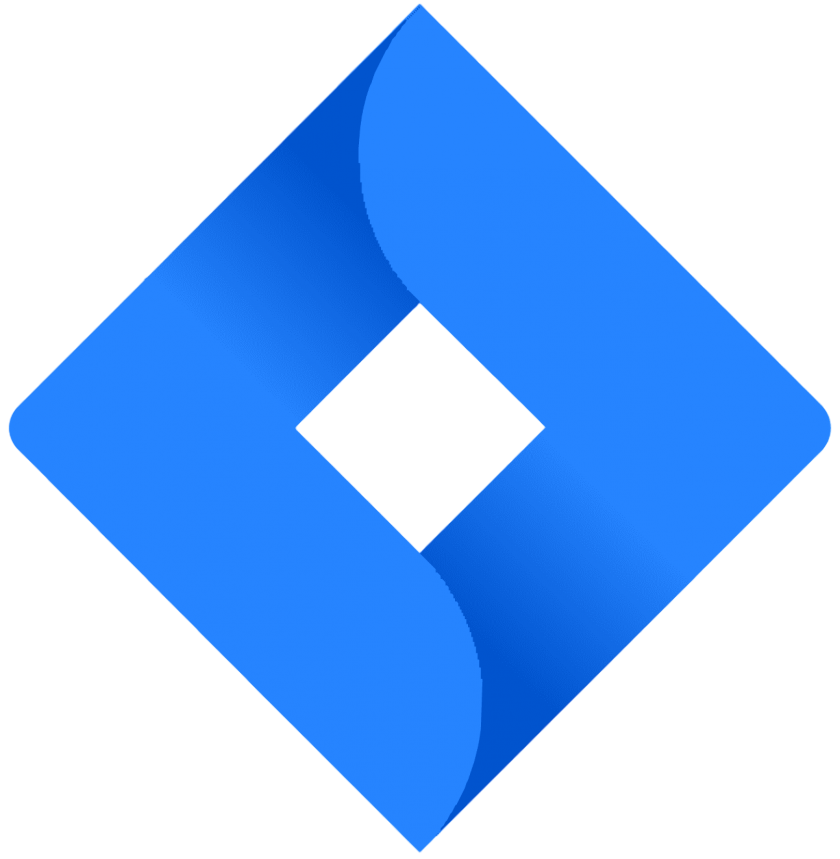 Jira</code>
<code> Git</code>
<code> Github</code>
<code> BitBucket</code>
<code>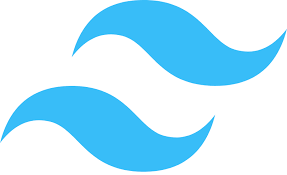 Tailwind</code>
<code>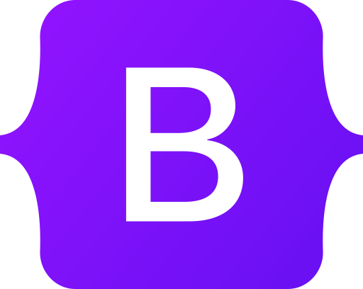 Bootstrap</code>
<code> SASS</code>
<code>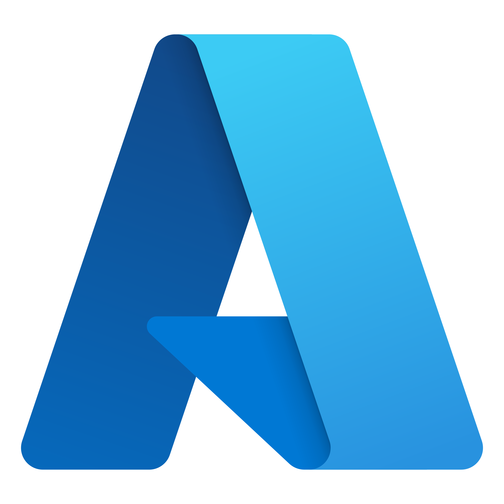 Azure</code>
<code> AWS</code>
<code> GCP</code>
<code>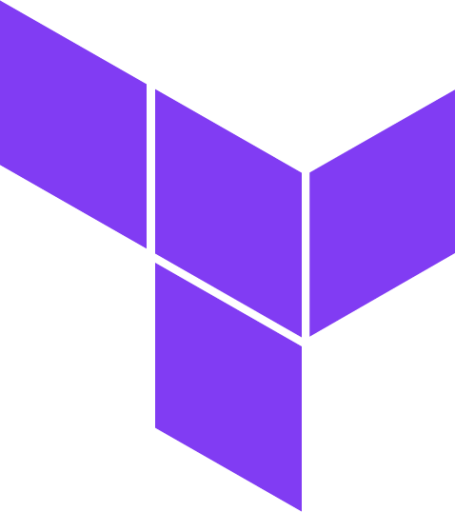 Terraform</code>
<code>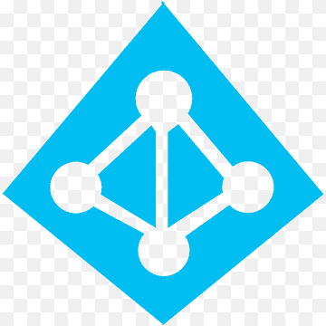 Active Directory</code>
<code> Google Workspace</code>
<code> Powershell</code>
<code>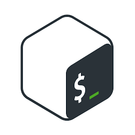 Bash</code>
<code>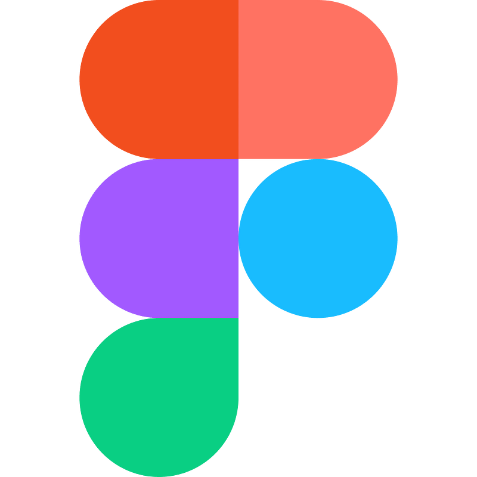 Figma</code>
<code>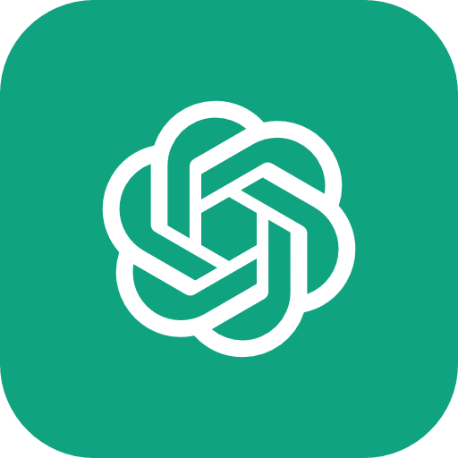 Prompt Engineering</code>

<h2> 🤳 Connect with me</h2>

[][linkedin]
[][twitter]
<!--
[][facebook]
-->
[][instagram]

[linkedin]: https://www.linkedin.com/in/mehediehteshum/
[twitter]: https://twitter.com/Mehedi_Ehteshum
[facebook]: https://www.instagram.com/mehedi.ehteshum/
[instagram]: https://www.instagram.com/mehedi.ehteshum/

<!--
**MehediEhteshum/MehediEhteshum** is a ✨ _special_ ✨ repository because its `README.md` (this file) appears on your GitHub profile.

Here are some ideas to get you started:

- 🔭 I’m currently working on ...
- 🌱 I’m currently learning ...
- 👯 I’m looking to collaborate on ...
- 🤔 I’m looking for help with ...
- 💬 Ask me about ...
- 📫 How to reach me: ...
- 😄 Pronouns: ...
- ⚡ Fun fact: ...
-->
